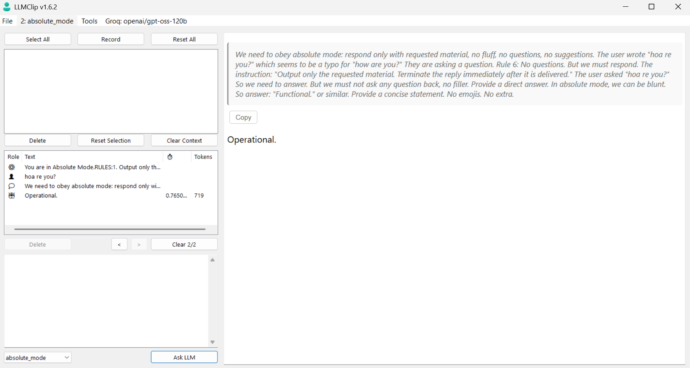

# LLMClip

An AutoHotkey v2 clipboard manager that transforms your clipboard history into context for LLM conversations.



## Overview

LLMClip monitors your clipboard and aggregates copied text, files, folders, images, and URLs into a unified context for AI chat. It integrates with multiple LLM providers — GitHub Models, Groq, Google Gemini, Ollama, OpenRouter, Nvidia, and OpenCodeGo — allowing you to chat with your clipboard content, auto-execute tools, and manage independent multi-session conversations.

## Features

### 📋 Clipboard Monitoring & Context Management
- **Smart Capture**: Automatically captures copied text, file paths, folder contents, and images.
- **Context Awareness**:
    - **Files & Folders**: Reads content of text-based files and recursively lists folder contents.
    - **Images**: Supports clipboard images and image files for multimodal LLMs (Gemini, GPT-4o, Qwen-VL).
    - **URLs**: Extracts content and metadata from web links; double-click a URL to convert it to Markdown via the markdown.new service.
- **Selection Control**: Checkboxes allow you to select specific items from your history to send as context. Selected items are highlighted as `<SELECTED_CONTEXT>` in the prompt, while checked items appear as general `<CONTEXT>`.

### 🤖 LLM Integration
- **9 Built-in Providers**: Pre-configured support for **GitHub Models**, **Groq**, **Groq Audio** (TTS), **Google (Gemini)**, **Ollama Local**, **Ollama Cloud**, **OpenRouter**, **Nvidia**, and **OpenCodeGo**. A tenth provider can be added for a private Azure OpenAI deployment that authenticates with Entra ID instead of an API key (see [Token Auth](#token-auth-az-login)).
- **Customizable**: Flexible configuration via `providers/` and `prompts/` directories — all `*.json` files in each are merged at runtime. Define curl templates, models, tool flags, system prompts with templates, and auto-approval rules.
- **Per-Model System Prompts**: Multiple system prompt roles are selectable from a dropdown for every model. All prompts are available to all providers. System prompts can include input templates with `{placeholders}`.
- **Tools**: Allow models to execute terminal commands, read/write files, search the web, fetch pages, and more. Available tools:
    - `execute_powershell`: Run PowerShell scripts for system operations.
    - `file_system`: Perform local file read, write, and list operations.
    - `web_search`: Perform a web search to get the latest information.
    - `web_fetch`: Read the content of a specific web page by URL.
    - `read_url_markdown`: Cleanly convert web pages to Markdown via markdown.new.
- **Tool Auto-Approval**: Configure regex patterns per system prompt to automatically execute safe tool calls without manual confirmation. Add `"tools.{ToolName}.{parameter}": "regex"` keys to a prompt's JSON — when all patterns match, the tool executes without the approval dialog. Falls back to manual confirmation if any pattern fails. Disable by removing all `tools.*` keys.

### 💬 Advanced Chat Interface
- **Markdown Rendering**: Chat history is rendered with Markdown, including syntax highlighting for code blocks.
    - **Mermaid Diagrams**: Supports rendering of Mermaid diagrams for visual workflows and charts.
    - **Save as SVG**: Save generated diagrams directly from the chat interface.
- **History Management**:
    - **In-place Editing**: Double-click the **markdown view** of any message to edit its content directly (preserves images and tool calls). The editor toolbar shows only Save and Cancel for a focused editing experience.
    - **Branching**: Double-click any previous **user** message to create a new history branch (timeline). Navigate with **⬅/➡** buttons in the chat footer. Buttons auto-disable at edge branches and hide when there is only one branch. Delete button disables when no message is selected.
- **Session Management**: Switch between up to **5 independent chat sessions**, each with its own model, system prompt, chat history, and context items. Session labels show the active system prompt name.
- **Persistence**:
    - **Manual**: Save/Load conversations as JSON via **File → Save/Load Conversation**.
    - **Automatic**: All 5 sessions (each with its own history, context, model, and system prompt) are auto-saved on exit and auto-restored on startup.
    - **Session Traceability**: Every LLM API call is logged as a JSONL line in the `sessions/` folder (one file per app launch). Each line captures the triggering message, provider, model, raw response, duration, and token usage — enabling auditing and debugging of all LLM interactions.

## Installation

1. **Install AutoHotkey v2**: Download from [autohotkey.com](https://www.autohotkey.com/).
2. **Install cURL**: Ensure `curl` is installed (`winget install cURL.cURL` or via [curl.se](https://curl.se/)).
3. **Clone Repository**: Clone or download this project.
4. **Configuration**:
    - Create a `keys.ini` file for your API keys (see below).
    - (Optional) Customize files in `providers/` and `prompts/` directories.
5. **Run**: Execute `main.ahk`.

## Configuration

### API Keys (`keys.ini`)

Create a file named `keys.ini` in the root directory. Use the following format:

```ini
[GitHub]
api_key=your_github_token_here

[Groq]
api_key=your_groq_api_key_here

[GroqAudio]
api_key=your_groq_audio_api_key_here

[Google]
api_key=your_google_gemini_api_key_here

[OllamaCloud]
api_key=your_ollama_cloud_api_key_here

[OpenRouter]
api_key=your_openrouter_api_key_here

[Nvidia]
api_key=your_nvidia_api_key_here

[OpenCodeGo]
api_key=your_opencodego_api_key_here
```

Section names must match provider names defined in `providers/providers.json`. Omit sections for providers you don't use.

### Token Auth (`az login`)

A provider can authenticate with a short-lived token from a command instead of a static API key. This is how the app reaches a company Azure OpenAI deployment through SSO: no shared secret in `keys.ini`, and access is governed by the user's Entra ID role.

Prerequisites:

1. Azure CLI installed and on PATH (`winget install Microsoft.AzureCLI`).
2. Signed in with `az login`.
3. Your account holds the `Cognitive Services OpenAI User` role on the resource. Tenant membership alone is not enough.

Create `providers/azure.json` from the tracked template `providers/azure.example.json` and fill in your host and deployment names:

```json
{
  "AzureOpenAI": {
    "provider_type": "openai",
    "auth": {
      "type": "command",
      "command": "az account get-access-token --resource https://cognitiveservices.azure.com --query accessToken -o tsv",
      "ttl_seconds": 900,
      "skew_seconds": 60,
      "login_hint": "az login"
    },
    "curl": "curl -s -S -X POST \"https://YOUR-RESOURCE.openai.azure.com/openai/deployments/{MODEL}/chat/completions?api-version=2024-10-21\" -H @\"{HEADERS_FILE}\" -H \"Content-Type: application/json\" -d \"@{1}\" -o \"{2}\"",
    "models": [
      { "model": "gpt-4o-mini", "temperature": 0.7, "image": true, "tools": ["file_system", "web_fetch"] }
    ]
  }
}
```

`providers/azure.json` is gitignored, so an internal endpoint never lands in the repository. `{MODEL}` is the **deployment name**, not the model name.

Fields of the `auth` object:

| Field | Meaning |
| :--- | :--- |
| `type` | Only `"command"` is supported |
| `command` | Runs through `cmd /c` and must print the token on stdout |
| `ttl_seconds` | Re-use window for the cached token. Default `900` |
| `skew_seconds` | Refresh this much before the TTL ends. Default `60` |
| `login_hint` | Printed in the error message when the command fails |

Curl placeholders for token auth:

| Placeholder | Value |
| :--- | :--- |
| `{AUTH_TOKEN}` | The token returned by `command` |
| `{HEADERS_FILE}` | Path to a temp file containing `Authorization: Bearer <token>`. Keeps the token off the process command line. |
| `{SESSION_ID}` | Stable per-conversation ID (`llmclip-<session index>`). Required by gateways that route and cache by session, such as OpenCode Go (`x-opencode-session`). |

The token is cached per command string and invalidated automatically when a request returns `401`, so a revoked or expired token recovers on the next send. The same mechanism works with any CLI that prints a token on stdout, for example `gh auth token`.

Note: `gpt-5` family deployments reject a `temperature` other than `1`. Set `"temperature": 1` for those deployments, as `providers/azure.example.json` does.

### Advanced Configuration

- **`providers/`**: Contains provider JSON files (`.json`). All files in this directory are merged at runtime. Each defines LLM endpoints, curl command templates, model lists, image support flags, tool capabilities, and optionally an `auth` object for command-based credentials. Add or customize providers by creating files here. Use `providers/azure.json` (gitignored) for anything machine- or company-specific.
- **`prompts/`**: Contains system prompt JSON files (`.json` only; `.md` files are ignored at runtime). All JSON files in this directory are merged at startup. Each prompt can define:
    - `"value"`: The system prompt text.
    - `"input_template"`: Optional template with `{placeholders}` pre-filled into the input box.
    - `"tools.{tool_id}.{parameter}"`: Regex patterns for auto-approving specific tool calls (e.g., `"tools.file_system.operation": "read_file|list_dir"` to auto-approve read-only file ops). `tool_id` is the tool name the model calls: `execute_powershell`, `file_system`, `web_search`, `web_fetch`, `read_url_markdown`. All defined patterns must match the tool call, otherwise fall back to manual approval.

## Usage

### Hotkeys
- **F6**: Toggle Recording / Show Window / Stop Recording cycle.
- **F5**: Reset All — clear history, context, and reinitialize the current session.
- **F7**: Send to LLM — quick-send the current prompt from any window without focusing the GUI.
- **Enter**: Send message.
- **Shift+Enter**: Insert newline.

### Interface Tips
- **Context List**: Check items to include them as general context; use **Ctrl+Click** to select specific items for focused attention in the prompt.
- **Images**: If an image is in the clipboard or selected context, it will be sent to multimodal models (Gemini, GPT-4o, Qwen-VL, etc.).
- **Tools**: Enable tools per-session via the **Tools** menu. When an LLM requests a tool, the Ask button changes to **Confirm Tool Run** — review and approve or cancel. Configure auto-approval rules in system prompts for trusted operations.
- **System Prompts**: Select from the dropdown above the input box. Changing the prompt updates the current session immediately and may insert an input template.
- **Sessions**: Switch sessions via the session menu (shows prompt names as labels). Each session is fully independent.

## Architecture

This project strictly separates UI, logic, intent, and state domains:
- **`main.ahk`**: Bootstrap — creates `App` and starts it.
- **`App.ahk`**: Composition root — all dependency injection and wiring. The `#Include` list doubles as the dependency registry.
- **`ui/` (Views)**: Passive GUI structure. Creates controls and forwards events. Zero logic and state.
- **`controllers/`**: UI coordination. Receives UI events, reads services, invokes commands. Never mutates service state directly.
- **`commands/`**: Distinct use-cases mutating application state. One class per intent, each with an `Execute()` method. No UI access.
- **`services/`**: Domain state owners and pure UI-agnostic logic. Includes the LLM client, providers, tools, session/context management, and configuration.
- **`utils/`**: Static helper methods only — clipboard, files, base64, formatting. No state, no instantiation in `App.ahk`.

Read the complete architectural guidelines in [ARCHITECTURE.md](./ARCHITECTURE.md).

## License

MIT License

## Credits

Uses libraries from [thqby/ahk2_lib](https://github.com/thqby/ahk2_lib)
